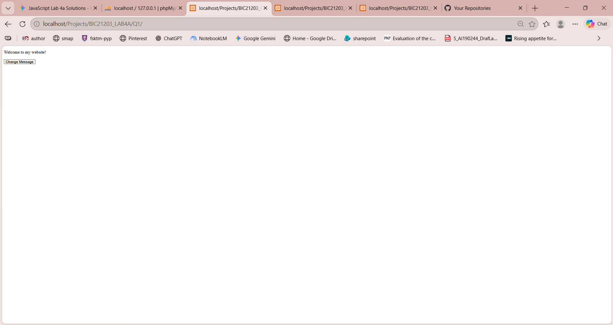
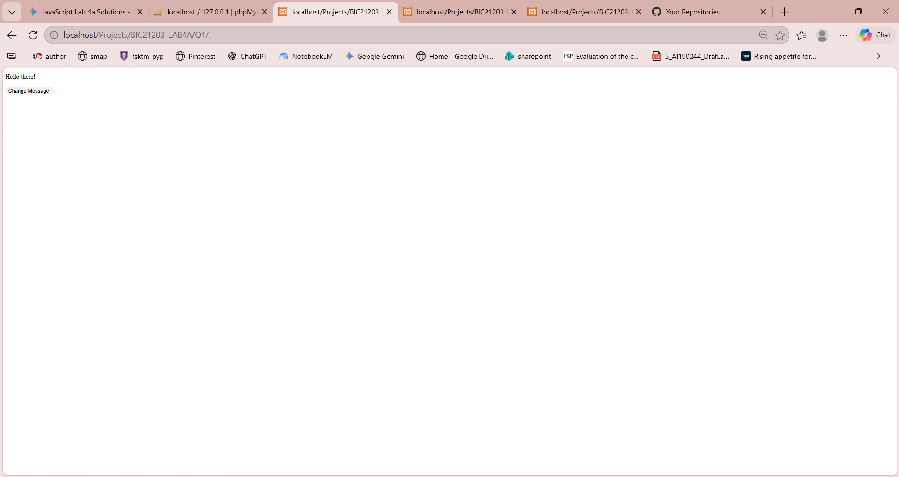
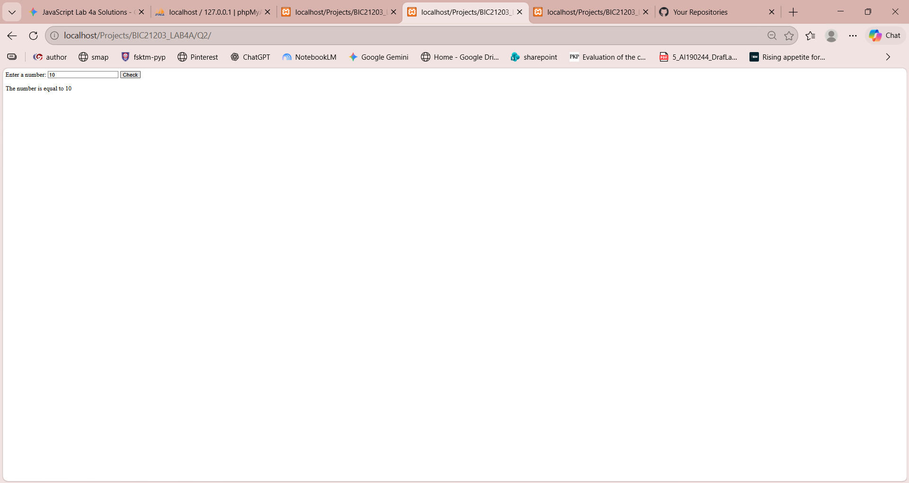
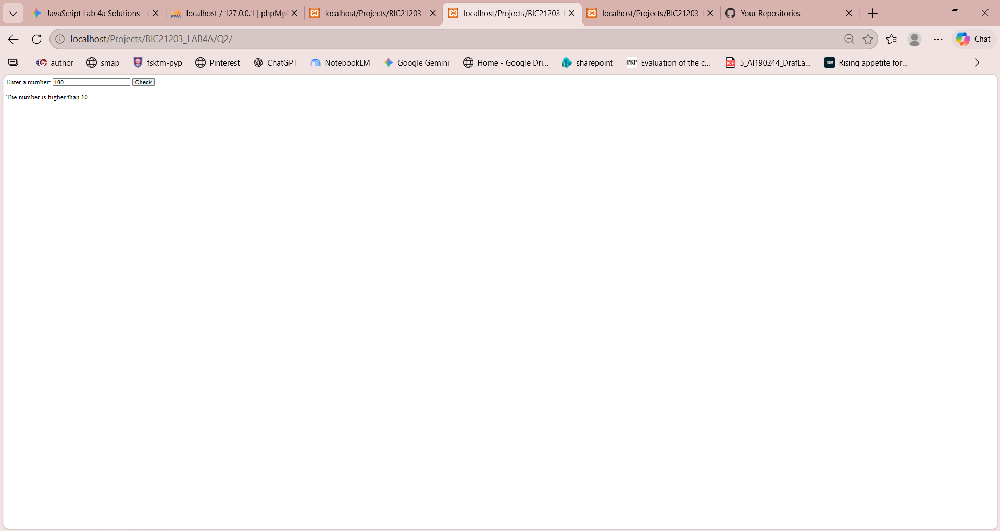
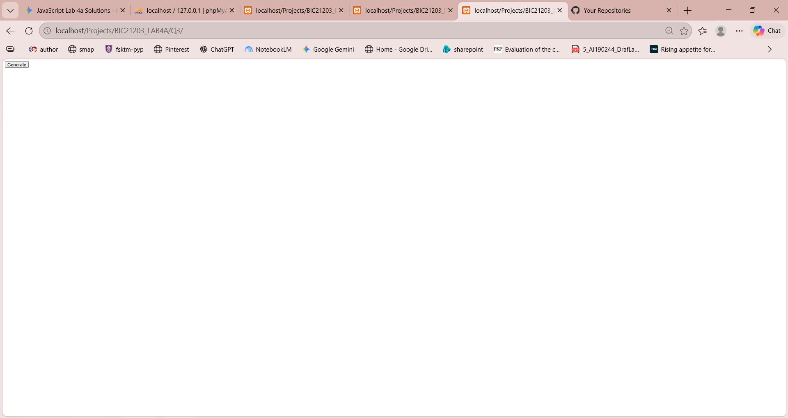
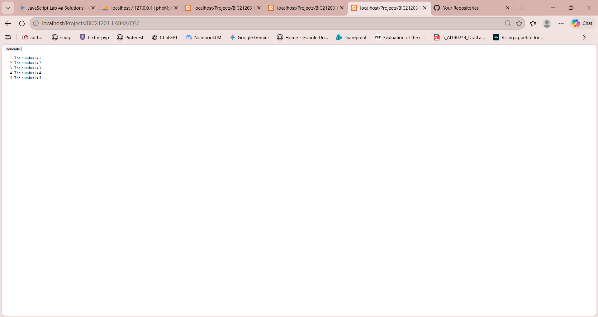

# BIC21203 Lab 4a: Client-Side Scripting (JavaScript)

**Name:** Raja Zarith Sofea binti Raja M. Tahar  
**Student ID:** AI240059

## Brief Explanation
This repository contains the completed exercises for Lab 4a, focusing on modern client-side JavaScript including DOM selection, event listeners, input validation using conditional statements (`if...else`) and dynamic element generation using `for` loops and `createElement()`.

## Repository Structure
- `Q1/index.html` - Interactive Text Changer (Question 1)
- `Q2/index.html` - Smart Number Validator (Question 2)
- `Q3/index.html` - Dynamic Number Generator (Question 3)

## Instructions to Run
1. Clone or download this repository to your local computer.
2. Open any question folder (`Q1`, `Q2`, or `Q3`).
3. Double-click the `index.html` file to open it in any current desktop web browser.

## Output Screenshots

### Question 1

### Question 2

### Question 3

